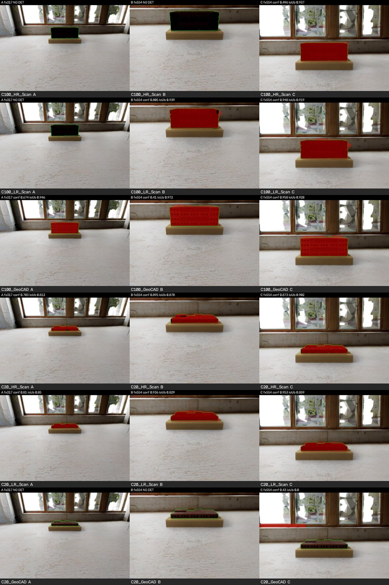
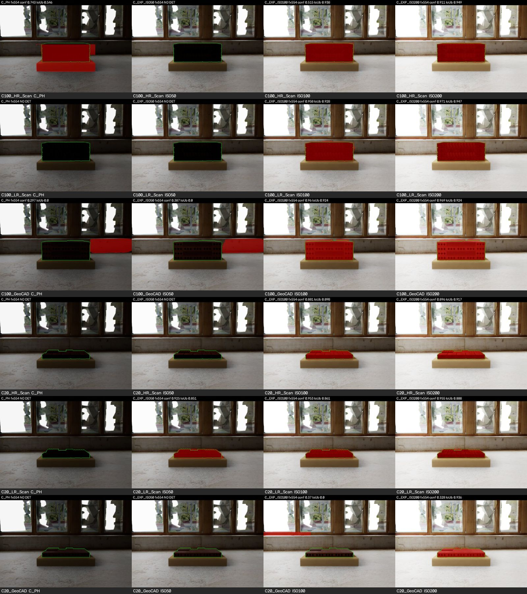
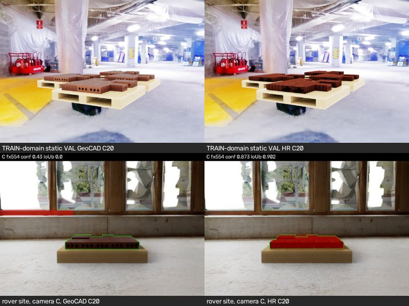

# C-V02 실제 카메라 렌더 검증과 CAD C20 무검출 진단 (2026-11-13 v01)

## 결론
1. **실제 카메라만 학습 조건(화각 fx 554, pitch −5°)으로 바꾸면 무검출 6건 중 4건이 해결됩니다.** 운영 카메라에서 검출되던 6/12가 10/12가 됩니다(장면 2개 × C100/C20 × HR/LR/CAD). 해결되는 4건은 HR·LR C100입니다. CAD C20 2건은 해결되지 않습니다.
2. **CAD C20 실패는 카메라 기하 문제가 아닙니다. 현장 조명(역광으로 어두운 벽돌)과 CAD 표현이 겹친 도메인 차이 문제입니다.**
   - 학습 카메라와 같은 화각·pitch·높이로 찍어도 실패합니다.
   - 같은 모델이 학습 도메인의 정적 Val에서는 CAD C20을 100% 검출합니다(conf 중앙값 0.96).
   - 노출을 1 stop 올리면(ISO 200) 처음 검출되지만, conf 0.33으로 기준 0.25를 겨우 넘깁니다.
3. **로버 카메라를 유지하면서 세 표현을 공정하게 비교하려면 최소한 다음이 필요합니다.** 로버 카메라 조건(fx 317, pitch −20°, 높이 0.59 m, 현장형 역광·노출 변화)의 합성 Train/Val 데이터를 HR/LR/CAD에 같은 장면·같은 수량·같은 학습 절차로 보강하고, 별도 버전으로 재학습합니다.
4. **기존 C06 모델을 로버 카메라 본실험에 그대로 쓰는 것은 권하지 않습니다.**
   - 운영 카메라에서는 표현마다 실패 양상이 체계적으로 다릅니다. HR·LR은 C100에서 무검출이고, CAD는 C20에서 무검출입니다.
   - 그래서 표현 비교가 "표현 품질"이 아니라 "현장 도메인 차이에 대한 민감도"를 재게 됩니다.
   - 카메라를 바꿔도 CAD C20이 남으므로 카메라 변경만으로는 부족합니다.
   - C06은 기준선(baseline)으로 보존합니다.

본실험(540회)과 실제 로봇 주행은 계속 HOLD입니다. 이번 결과는 모두 진단용이며 정식 성능 분모에 넣지 않았습니다.

## 1. 범위와 보존
- **실행한 것**
  - 실제 Isaac Sim RTX 정지 캡처 18회(12 + 노출 sweep 6). 모두 `CAMERA_DIAG_CAPTURE_PASS`, 회당 약 24초.
  - 고정 C06 모델 추론, ROBUST_A, TC-S 계산.
  - 정적 Val 이미지 추론(Test 미사용).
- **로봇:** 제어 명령 0, 주행 0. 각 캡처 전에 PhysX 240 step으로 정지 안착만 했고, 위치 변화는 5 mm 미만입니다.
- **바꾸지 않은 것:** 운영 카메라 prim, 모델, confidence(0.25), protocol, manifest, 학습 데이터. 기존 Codex Controller/Watchdog와 저장 승인 상태에는 접근하지 않았습니다.
- **진단 카메라:** 실행마다 새로 만든 준비 stage 안에 `/World/CamDiag/B`, `/World/CamDiag/C` prim을 **새로 추가**했습니다.
  - 위치는 안착된 운영 카메라의 월드 자세와 같고(스케일만 제거), USD 원본은 그대로입니다.
  - 기존 RGB를 확대·회전한 이미지는 쓰지 않았습니다. 모든 조건을 실제로 새로 렌더했습니다.
- **GT:** instance segmentation prim 경로로 벽돌만(`Load_01/ActualBrickLoad`)과 팔레트(`Load_01/T11_Pallet`)를 나눠 `eval_gt_only/`에 따로 저장했습니다. 추론·ROBUST_A·TC-S에는 들어가지 않습니다.

**장면**

| 장면 | 출처 | 용도와 한계 |
|---|---|---|
| VAL09 (주 장면) | `CDEP_B1R_VAL_000009` FULL_C100 / T01_C20. 적층 ABAB, red | Test 계보와 독립입니다. 단, 이 Val은 C06 체크포인트 선택(best_balanced)에 쓰인 split이라 약간 낙관적일 수 있습니다. |
| TST_B01 (참조) | 기존 C2D_B01 (Test 계보) | 진단 비교용으로만 썼습니다. 성능 수치나 모델 선택에는 쓰지 않았습니다. |

- 두 장면 모두 단일 적재물이고, 시작점은 E1입니다(중심 (−25.888, 30.509)에서 3.2 m 앞, 좌우 0, yaw 90°).
- 카메라–중심 거리 2.659 m, 카메라 높이 0.593 m.
- C100 공칭 형상이 split 사이에 공유되므로 두 장면의 화면은 거의 같습니다. 같은 결과가 두 번 재현된 것으로 해석하고, 독립 표본 2개로 세지 않습니다.

**카메라 조건** (모두 실제 렌더)

| 조건 | 내용 | fx | pitch |
|---|---|---|---|
| A | 운영 로버 카메라 그대로 | 317.0 | −20.3° |
| B | 같은 위치·방향, 초점거리만 학습 카메라에 맞춤 | 554.26 | −20.3° |
| C | B + 광축 pitch를 학습 범위(−4 ~ −5.6°)인 −5°로 | 554.26 | −5.0° |
| A_PH / C_PH | A, C에 학습 데이터 렌더의 노출 설정을 고정(tonemap op 6, ISO 25, 1/50, f/5) | | |
| C_EXP_ISO50/100/200 | C에서 ISO만 바꾼 노출 sweep (VAL09) | | |

- 학습 카메라: focal 18.148 mm / 수평 aperture 20.955 mm → fx 554.26, 높이 0.6 m, 적재물 중심을 바라봄.
- 로버 카메라 높이(0.593 m)는 학습 카메라와 거의 같습니다. 차이는 화각과 pitch입니다.

## 2. 실제 카메라 변경 결과

목표 검출 = 운영 설정(conf 0.25)의 top-1 마스크가 벽돌 GT와 IoU 0.5 이상인 경우입니다.

**검출 수 (VAL09 / TST_B01, 각 6건)**

| 조건 | HR C100 | LR C100 | CAD C100 | HR C20 | LR C20 | CAD C20 | 합계 |
|---|---|---|---|---|---|---|---|
| A 운영 | ✗/✗ | ✗/✗ | ✓/✓ | ✓/✓ | ✓/✓ | ✗/✗ | **6/12** |
| B fx만 | ✗/✓ | ✓/✓ | ✓/✓ | ✓/✓ | ✓/✓ | ✗/✗ | **9/12** |
| C fx+pitch | ✓/✓ | ✓/✓ | ✓/✓ | ✓/✓ | ✓/✓ | ✗/✗ | **10/12** |
| A_PH 학습 노출 | ✗/✗ | ✗/✗ | ✗/✗ | ✗/✗ | ✗/✗ | ✗/✗ | 0/12 |
| C_PH 학습 노출 | ✓/✓ | ✗/✗ | ✗/✗ | ✗/✗ | ✗/✗ | ✗/✗ | 2/12 |

**VAL09 상세 (top-1 conf / 벽돌 IoU)**

| 표현·적재율 | A | B | C | 벽돌 화소 A→C | 벽돌 밝기 (학습 Val 중앙값) |
|---|---|---|---|---|---|
| HR C100 | 무검출 (최고 후보 conf 0.017) | 무검출 (0.197) | 0.47 / 0.94 | 7,710 → 21,463 | 3.6 (49) |
| LR C100 | 무검출 (0.053) | 0.81 / 0.94 | 0.95 / 0.92 | 7,663 → 21,433 | 3.0 (42) |
| CAD C100 | 0.69 / 0.95 | 0.40 / 0.97 | 0.96 / 0.93 | 7,798 → 21,960 | 19.7 (117) |
| HR C20 | 0.72 / 0.81 | 0.89 / 0.88 | 0.88 / 0.90 | 3,145 → 9,137 | 14.7 (57) |
| LR C20 | 0.81 / 0.85 | 0.94 / 0.83 | 0.95 / 0.86 | 3,073 → 9,007 | 5.5 (41) |
| CAD C20 | 무검출 (0.021) | 무검출 (후보 없음) | 오검출 0.46 / 0.00 (창틀) | 3,247 → 9,545 | 39.4 (114) |

**추가 기록**
- **clipping:** 모든 조건에서 적재물 GT가 화면 경계에 닿지 않았습니다. B에서는 적재물 윗변이 53행까지 올라가 C100의 여유가 작습니다.
- **유효 Depth:** 벽돌 GT 화소 100%가 유효했습니다(A 약 3,000–7,800점, C 약 9,000–22,000점).
- **ROBUST_A와 TC-S**
  - 목표를 검출한 경우 모두 ROBUST_A가 계산됐고(B5_COMPUTED), TC-S도 통과했습니다.
  - 위치 오차는 A ≤ 0.35 cm, C ≤ 0.18 cm, TC-S 최대 곡률은 0.007–0.015로 한계 0.364보다 훨씬 작습니다.
  - 목표가 아닌 것을 고른 경우에는 ROBUST_A가 DATUM_REJECTED 또는 DEPTH_INSUFFICIENT로 거부했습니다. 단, A_PH HR C20 1건은 IoU 0.27로 계산까지 진행됐습니다.
- **해석**
  - C100의 HR·LR 무검출은 화각과 pitch를 학습 조건으로 맞추면 사라집니다.
  - 다만 목표 크기 자체는 운영 카메라(A)에서도 학습 분포 안에 있습니다. 예를 들어 C100 벽돌 7,700 px는 학습 Train 중앙값 5,358 px보다 큽니다.
  - 따라서 원인은 "목표가 너무 작다"보다 광각·하향 시점 전체의 모습(바닥 비중, 원근, 배경 구성)이 학습 화면과 다르다는 데 가깝습니다.
  - HR C100은 C에서도 conf 0.47–0.60으로 여유가 작습니다.

*그림 1. VAL09 실제 렌더. 열은 A 운영, B fx만, C fx+pitch입니다. 빨강은 운영 top-1 예측 마스크, 초록 윤곽은 평가 전용 벽돌 GT입니다.*

**노출 통제 (VAL09, 카메라 C, 다른 조건 고정)**

| 노출 | 화면 밝기 | 검출 | CAD C20 |
|---|---|---|---|
| 학습 노출 고정 ISO 25 | 75 | 1/6 | 무검출 |
| ISO 50 | 106–111 | 1/6 (LR C20만) | 무검출 |
| ISO 100 (기본 렌더와 거의 같음) | 140–147 | 5/6 | 오검출 (창틀) |
| ISO 200 (+1 stop) | 172–181 | **6/6** | **0.33 / 0.94, ROBUST_A·TC-S 통과** |

- 학습 데이터 렌더의 노출 수치(ISO 25)를 그대로 옮기면 오히려 어두워져 거의 모두 실패합니다. 학습 장면(B1 실내, 밝은 dome)과 로버 현장(창 역광)의 조명 구조가 다르기 때문입니다. 즉, 노출 "수치"를 맞추는 것은 해법이 아닙니다.
- 밝기를 올리면 모든 표현의 conf가 오릅니다(HR C100 0.50 → 0.91).

*그림 2. 카메라 C 노출 sweep. 열은 학습 노출 고정(ISO 25), ISO 50, ISO 100, ISO 200입니다.*

## 3. CAD C20 무검출 진단

| 점검 항목 | 결과 | 판단 |
|---|---|---|
| 벽돌이 화면에 보이는가 | A 3,247 px, C 9,545 px. 잘림 없음. 유효 Depth 100%. 구멍 난 면이 선명히 보임 | 가시성 문제 아님 |
| 저신뢰도 후보가 있는가 (conf 0.001, 진단 전용) | A·B: 벽돌과 겹치는 후보가 거의 없음(최대 IoU 0.012, 후보 0–3개). C: IoU 0.93 후보가 있으나 conf 0.011–0.014 | 모델이 벽돌을 거의 "목표 같지 않다"고 봄 |
| 마스크가 팔레트를 고르는가 | 오검출 top-1의 팔레트 비율 0.00. C의 top-1은 창틀(그림 1 맨 아래 오른쪽) | 팔레트 선택 문제 아님 |
| 학습 자료의 적재율·카메라 차이 | 학습 CAD C20 라벨: 학습 Train 549개, 크기 중앙값 5,369 px, 높이 39 px. 로버 C20은 3,247 px / 높이 52 px로 범위 안. 카메라 높이 0.6 vs 0.593 m. **밝기는 학습 114 vs 로버 39 (0.35배)** | 크기·높이·각도는 범위 안이고, 밝기·배경이 다름 |
| 학습 도메인에서는 되는가 | 같은 C06 CAD 모델, 정적 Val CAD C20 165개: 검출률 **1.00**, conf 중앙값 0.96 | 모델 자체 능력 문제 아님 |
| brick-only GT로 바르게 평가했는가 | instance prim 경로로 벽돌만 GT를 만들었습니다(팔레트 분리). 이전 v01 보고서의 IoU 0.43 문제는 팔레트 포함 GT 때문이었고, 이번에 해소했습니다. 이번 판정은 GT 정의와 무관하게 무검출 또는 IoU 0입니다. | 평가 오류 아님 |
| 노출을 올리면 | ISO 200에서 conf 0.33으로 검출 | 조명·밝기에 민감 |

- **결론:** CAD C20 실패는 카메라 기하(화각·pitch) 문제가 아닙니다.
  - "역광 현장에서 어둡게 찍힌 CAD 벽돌" 모습이 CAD 학습 데이터(밝고 균일한 주황색 CAD 재질)와 다르고, 단층(C20)이라 단서가 적은 것이 겹친 **도메인 × 표현 상호작용**입니다.
  - HR·LR은 학습 때부터 어두운 텍스처(라벨 밝기 39–60)로 학습돼, 현장에서 더 어두워져도(3–15) 검출됩니다. CAD는 학습 밝기가 114로 높아 현장 밝기 차이에 가장 민감합니다.
  - 이것은 단일 장면 관찰입니다. 일반화하려면 여러 현장 조명에서 확인해야 합니다.

*그림 3. 위는 학습 도메인 정적 Val(같은 VAL09 C20, 학습 카메라), 아래는 로버 현장 카메라 C. 왼쪽 GeoCAD, 오른쪽 HR.*

## 4. 해결 방식 비교

| 항목 | A. 운영 카메라를 학습 카메라에 맞춤 | B. 로버 카메라 유지 + 로버 조건 합성 데이터 보강·재학습 |
|---|---|---|
| 이번 실측 효과 | 무검출 6 → 2 (C100 해결). CAD C20 남음. 노출까지 올리면 6/6이지만 CAD C20 conf 0.33으로 여유 없음 | 미실측. 새 학습 필요 |
| 표현 간 공정성 | 같은 카메라라 형식상 공정합니다. 그러나 남은 실패(CAD C20)가 표현에 따라 다르게 생겨 비교를 오염시킵니다 | 세 표현에 같은 장면·수량·절차를 적용하면 공정합니다. 도메인 차이를 줄인 뒤 표현 차이를 볼 수 있습니다 |
| 로봇 쪽 영향 | 화각이 수평 90° → 60°로 좁아집니다. pitch −5°이면 가까운 바닥이 덜 보여 접근 마지막 구간의 관측·안전 시야가 줄어듭니다. 실제 로버 카메라 사양과 달라 현실성이 낮아집니다 | 로봇·카메라는 그대로 |
| 비용·시간 | 작음. 카메라 설정 개정, 정지 재검증 12–18회(약 10분) | 큼. 렌더(표현 3 × 수백 장) + 학습(표현 3 × seed) + Val 검증. 대략 반나절–1일 GPU |
| 위험 | 노출 설정을 현장에 맞춰 고르면 그 자체가 튜닝이 됩니다. Val로만 미리 고정해야 합니다 | 현장(v30 site)과 같은 배경으로 학습하면 현장 누설이 생깁니다. 학습용 현장 변형과 본실험 현장을 분리해야 합니다 |
| 기존 결과와의 관계 | C06 그대로 사용 | C06과 Test 결과는 보존하고, 새 버전 Train/Val로 별도 학습합니다 |

**방법 B를 공정하게 설계하는 최소 조건** (설계만 했고 실행하지 않음)
1. **촬영 분포**
   - 로버 카메라 그대로: fx 317, pitch 약 −20°, 높이 0.59 m.
   - 시작점 분포: 중심거리 2.9–3.6 m, 좌우 ±0.2 m, yaw ±6°.
   - 노출·조명 변화: 역광·순광, ISO 50–200 상당.
   - 적재율 C100–C20 균등.
2. **세 표현 동일**
   - 같은 장면 목록, 같은 depletion seed, 같은 수량(예: 표현당 rover-domain Train 300 + Val 60).
   - 표현별 자산만 교체합니다(기존 C-V02 생성 규칙과 같은 방식).
3. **현장 분리**
   - 학습·Val은 본실험 v30 현장과 다른 배경·창 배치 변형을 씁니다.
   - 본실험 현장과 Test 계보 장면은 학습·선택에 쓰지 않습니다.
4. **학습 절차 동일**
   - 기존 C06 recipe와 seed(42/43/44)를 쓰고, 데이터 혼합 비율은 미리 고정합니다.
   - HPO를 다시 할 경우 새 rover-domain Val로만 합니다.
   - 기존 Test 결과로 모델이나 HPO를 고르지 않습니다.
5. **사전 잠금:** manifest·recipe SHA를 결과를 보기 전에 잠급니다.
6. **합격 기준(사전 선언 제안):** rover-domain Val에서 세 표현 모두 C100·C20 검출률 0.9 이상. 이번 18회 정지 캡처 묶음을 재검증용 engineering 세트로 쓰고, 분모에서는 제외합니다.

## 5. 최종 질문에 대한 답
1. **실제 카메라 변경만으로 기존 무검출이 얼마나 해결되는가?**
   - fx만 바꾸면 6건 중 3건, fx와 pitch를 함께 바꾸면 6건 중 4건(HR·LR C100)이 해결됩니다. 검출 수는 6/12 → 10/12입니다.
   - CAD C20 2건은 해결되지 않습니다. HR C100은 해결돼도 conf 0.47–0.60으로 여유가 작습니다.
2. **CAD C20 실패는 카메라 문제인가?**
   - 카메라 기하 문제가 아닙니다. 모델 능력 문제도 아닙니다(학습 도메인 Val 100%). 평가 오류도 아닙니다.
   - 현장 조명·노출 도메인 차이에 CAD 표현이 특히 약한 **도메인 × 자재 표현 상호작용**입니다.
3. **로버 카메라를 유지하면서 공정하게 평가하려면 최소한 무엇을 바꿔야 하는가?**
   - 모델 학습 데이터에 로버 카메라·현장형 조명 조건을 세 표현 동일하게 보강해야 합니다(4절 방법 B의 1–6).
   - 카메라·protocol·성공 기준은 그대로 둡니다. 시작 격자 개정(v01 보고서: 중심거리 3.2 m, 좌우 {0, ±3 cm})은 경로 쪽에서 별도로 필요합니다.
4. **C06을 그대로 써도 되는가?**
   - 로버 카메라 본실험에는 그대로 쓰지 않는 것을 권합니다. 동일 조건의 데이터 보강과 별도 버전 재학습이 필요합니다.
   - 시간이 급하면 차선책은 방법 A(카메라 C + 노출 사전 고정)입니다. 이 경우에도 CAD C20의 여유가 거의 없어(conf 0.33), 표현 비교 결론에 그 한계를 명시해야 합니다.

## 6. 산출물과 재현
**코드** (모두 신규 버전, 원본 미수정)
- `evaluation/c_v02_camera_diag_scene_20261113_v01.py` (sha 3dee02ae…)
  - `c_v02_drive540_scene_20261113_v04.py`의 복사본입니다. 바뀐 것은 Val 장면 형상 행을 직접 받는 인자 하나뿐입니다.
- `scripts/c_v02_camera_diag_capture_20261113_v01.py` (8090d9ab…), `_v02.py` (a9b4e75a…, 노출 sweep 추가)
  - 운영 v06(231e5fef…)과 같은 장면 구성·정지 안착을 쓰고, 진단 카메라만 추가했습니다.
- `analysis/c_v02_camera_real_diag_eval_20261113_v01.py` (c6ff91c7…), `_v02.py` (b03080da…)
- `analysis/c_v02_c20_training_domain_20261113_v01.py` (14eb0916…)

**결과 디렉터리** (`/home/user/hh/isaac_cosmos/sdg_final/` 아래, Git 미포함)
- `C_V02_CAMERA_REAL_DIAG_20261113_v01_run01/` (12 캡처), `..._v02_run01/` (6 캡처)
- `C_V02_CAMERA_REAL_DIAG_EVAL_20261113_v01_run01/`, `..._v02_run01/`
- `C_V02_C20_TRAINING_DOMAIN_20261113_v01_run03/`

**실패한 시도** (기록용 보존)
- `C_V02_C20_TRAINING_DOMAIN_20261113_v01_run01_FAILED_emptylabels`: dataset의 `labels/*.txt`는 의도된 빈 placeholder입니다. 실제 GT는 `MIX_C06/bitmap_registry.json` bitmap이라 GT 출처를 고쳤습니다.
- `..._run02_FAILED_valfilter`: Val 파일명 접두사 필터 오류.
- 첫 캡처의 `ALL_DONE`은 SMOKE 실행에서 잘못 생긴 표식이었습니다. 실제 실행은 정상 완료됐고, `driver.log`에 정정을 남겼습니다.

**보고서 첨부** (`reports/c_v02_real_camera_diag_20261113_v01/`)
- 그림 3개
- `real_camera_diag_run01_VAL09_TSTB01.csv`, `real_camera_diag_run02_VAL09_exposure.csv`
- `training_label_stats.csv`, `val_static_eval_summary.csv`

**미해결과 한계**
- 장면 1개(VAL09)와 참조 1개만 봤습니다. 노출 sweep은 VAL09에만 했습니다.
- 다른 시작점(E2 등)과 다른 현장 조명은 확인하지 않았습니다.
- HR C100의 낮은 conf 여유도 확인이 더 필요합니다.
- 방법 B의 효과는 미실측입니다.
